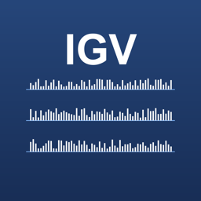
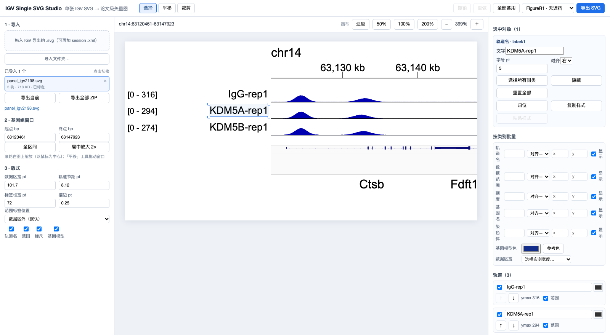

<p align="center">
  <b>English</b> · <a href="README.zh-CN.md">简体中文</a>
</p>

<p align="center">
  
</p>

<h1 align="center">IGV Studio</h1>

<p align="center">
  Turn an IGV Desktop SVG export into a publication-ready vector figure — edit labels, ranges, gene annotations and track order in a real canvas, then export clean SVG for Illustrator.
</p>

<p align="center">
  
</p>

---

## Why

IGV Desktop exports a single SVG per locus. The signal is already correct, but the labels, axis ranges, fonts and track order are fixed, and text is often baked into positions you cannot adjust. Re-rendering the track in another tool risks changing the science.

IGV Studio edits **only the annotation layer** of that exported SVG. Signal geometry is never redrawn, re-binned or smoothed — the curve you see is the curve IGV produced.

## Features

- **Signal-safe editing** — bars, peaks and gene models keep their original geometry; cropping and zooming never change peak height.
- **Direct on-canvas editing** — drag any label, tick, range or gene name; multi-select with Shift or a marquee; align with snapping guides.
- **Category-level batch styling** — set font size, alignment, colour, visibility and X/Y offsets once for all track names / ranges / ticks / genes / chromosome labels.
- **FigureR1 presets** — measured from a real publication figure: 5 / 4 / 6 pt type, 8.12 pt track pitch, 0.25 pt rules, plus “exact” and “no-overlap” range layouts.
- **Genome window navigation** — scroll to zoom the locus around the cursor, drag with the Pan tool, or crop to a region; the ruler and calibration follow.
- **Multi-document workspace** — import many SVGs, switch between them, keep per-document undo history, apply one preset to all.
- **Batch export** — write one SVG per figure, or a ZIP containing every figure plus a manifest that records each file's calibration and a re-parse check.
- **Local only** — files never leave your machine; no account, no upload, no telemetry.

## Download

Grab the latest build from **[Releases](https://github.com/quii490/igv-studio/releases/latest)**.

| Platform | File | Notes |
|---|---|---|
| macOS (Apple Silicon) | `IGV-Studio-tauri-arm64.dmg` | macOS 11+ |
| macOS (Intel) | `IGV-Studio-tauri-x64.dmg` | macOS 11+ |
| Windows 10/11 (x64) | `IGV-Studio-tauri-windows-x64.zip` | Contains installer + portable exe |

Each release ships `SHA256SUMS.txt` and `VERSION.json` so you can verify what you downloaded.

```bash
shasum -a 256 -c SHA256SUMS.txt          # macOS
certutil -hashfile "IGV Studio_2.0.0_x64-setup.exe" SHA256   # Windows
```

## Install

### macOS

1. Open the `.dmg` and drag **IGV Studio** into **Applications**.
2. First launch is blocked by Gatekeeper because the build is not notarised:
   **System Settings → Privacy & Security → “IGV Studio” was blocked → Open Anyway**.
3. Afterwards it opens normally.

Prefer the terminal?

```bash
xattr -dr com.apple.quarantine "/Applications/IGV Studio.app"
```

> macOS 15 and later removed the old right-click → Open shortcut for unsigned apps; use the Settings path above.

### Windows

1. Unzip and run `IGV Studio_2.0.0_x64-setup.exe` (or `igv-studio-portable.exe` to skip installing).
2. SmartScreen will warn because the build is unsigned: **More info → Run anyway**.
3. The app needs the WebView2 runtime. Windows 11 and up-to-date Windows 10 already have it; if not, the installer downloads it automatically (internet connection required).

## Quick start

1. In **IGV Desktop**, frame the locus and y-axis you want, then `File → Save SVG Image`.
2. Drop the `.svg` anywhere onto the IGV Studio window.
3. Edit labels, fonts and layout, then press **Export SVG**.

```
IGV Desktop ──Save SVG Image──▶ IGV Studio ──Export SVG──▶ Illustrator (assemble the figure yourself)
```

IGV Studio deliberately does **not** compose multi-panel figures. One locus per file, one file per export.

## Editing

| Tool | Shortcut | What it does |
|---|---|---|
| Select | `S` | Click to select, Shift-click to add, drag on empty canvas to marquee, drag an object to move it |
| Pan | `H` | Drag to move the genome window |
| Crop | `C` | Drag to set the visible interval |

Handy keys: `⌘/Ctrl+Z` undo, `⇧⌘/Ctrl+Z` redo, arrow keys nudge the selection (Shift = 5 pt), `Delete` hides selected objects, `Esc` clears the selection, Space-drag pans the canvas.

**Zoom** — use the toolbar (`Fit`, `50%`, `100%`, `200%`, `±`) for the canvas, `⌘/Ctrl + scroll` to zoom the canvas around the cursor, and plain scroll to zoom the genome window.

**Categories** — the right panel applies to one object when something is selected, and to a whole category otherwise. Precedence: preset → category style → per-object override.

**Track names** — IGV file names are often long. Use **轨道名映射** in the import panel to map them (one `file name, display name` per line, or a JSON object); the mapping is remembered between sessions. Without a mapping the app just strips common decorations (`_clean`, `_Filtered`, `_10bp`, `_rpgc`).

**Unsupported SVG** — if a file parses but has no recognisable signal tracks (a different IGV writer, path-based marks), the original drawing is shown read-only with a diagnostic banner; “Export SVG” then saves the untouched original instead of a blank editor.\n\n**Multiple files** — every imported SVG becomes a document in the left list; switching keeps its own undo history, and **Apply to all** pushes the current template to every document.

## Export

- **Export SVG** writes the current document.
- **Export all (ZIP)** writes one SVG per document plus `export_manifest.json`, which records calibration mode, warnings, and a re-parse check that the exported file still contains every signal object.

Exports contain no raster images, no `foreignObject`, and text stays editable `<text>`.

## Known limitations

- Builds are **unsigned**: macOS needs Gatekeeper approval once, Windows needs SmartScreen approval once.
- **Windows builds have not been smoke-tested on a real Windows machine** by the maintainer — please report anything odd.
- Validation used a real 3-track IGV 2.19.8 export; 15-track numbers come from a **synthetic** stress fixture (documented as such).
- Illustrator compatibility was not verified by the maintainer; exported SVG is plain `<text>` + geometry.
- Tick label offsets are keyed by genomic position, so they realign when you change the genome window.

## Privacy

Everything runs locally. The app makes no network requests except the Windows WebView2 bootstrap performed by the installer when the runtime is missing.

## Build from source

Requires Node 20+ and Rust (stable) for the desktop shell.

```bash
npm install
npm run build            # frontend
npm run tauri:build      # macOS app + dmg
npm run tauri:build:x64  # Intel build
```

Development, tests and validation details: [`docs/DEVELOPMENT.md`](docs/DEVELOPMENT.md) · Detailed usage: [`docs/USAGE.md`](docs/USAGE.md) · Validation reports: [`docs/validation/`](docs/validation/).

## License

[MIT](LICENSE)
