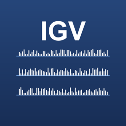
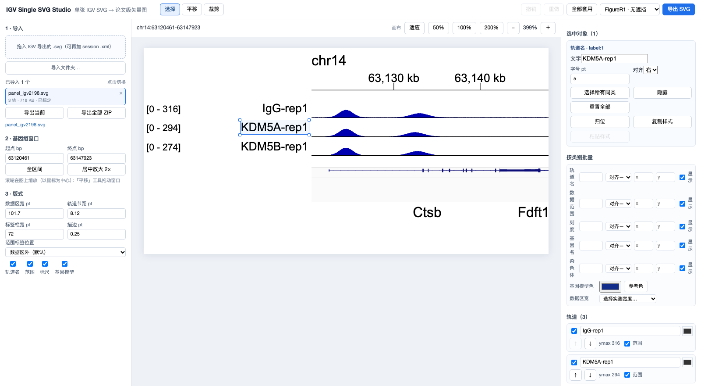

<p align="center">
  <a href="README.md">English</a> | <b>简体中文</b>
</p>

<p align="center">
  
</p>

<h1 align="center">IGV Studio</h1>

<p align="center">
  把 IGV Desktop 导出的单张 SVG 变成可直接用于发表的矢量图：在真正的画布上改文字、坐标范围、基因注释和轨道顺序，再导出干净的 SVG 给 Illustrator。
</p>

<p align="center">
  
</p>

---

## 为什么需要它

IGV Desktop 每个位点导出一张 SVG。信号本身是对的，但标签、坐标范围、字体、轨道顺序都是死的，文字位置也改不了。换一个工具重画曲线，就等于拿科研数据冒险。

IGV Studio **只改注释层**：信号图形的几何、数量、对齐全部保持 IGV 输出的原样，裁剪和缩放都不会改变峰高。

## 功能

- **不重绘信号** —— 柱子、峰、基因模型保持原始几何；裁剪、缩放不改变纵轴映射。
- **画布上直接编辑** —— 拖动任意标签、刻度、数据范围、基因名；Shift 多选或框选；吸附参考线对齐。
- **按类别批量改样式** —— 轨道名 / 数据范围 / 刻度 / 基因名 / 染色体，一次改字号、对齐、颜色、显隐和 X/Y 偏移。
- **FigureR1 预设** —— 按真实发表图实测：5 / 4 / 6 pt 字号、8.12 pt 轨道节距、0.25 pt 线条，另有“精确复刻”和“无遮挡”两种范围布局。
- **基因组窗口导航** —— 滚轮以光标为中心缩放、平移工具拖动、裁剪工具框选；标尺与坐标随之同步。
- **多文档工作区** —— 一次导入多张 SVG，随时切换，每张图有独立撤销历史，也可以把模板一次套用到全部文档。
- **批量导出** —— 单张导出，或打包 ZIP（每张图一个独立 SVG + 清单，记录标定状态与逐张重新解析的校验结果）。
- **完全本地** —— 文件不上传，无账号、无遥测。

## 下载

到 **[Releases](https://github.com/quii490/igv-studio/releases/latest)** 下载最新版。

| 平台 | 文件 | 说明 |
|---|---|---|
| macOS（Apple Silicon） | `IGV-Studio-tauri-arm64.dmg` | macOS 11+ |
| macOS（Intel） | `IGV-Studio-tauri-x64.dmg` | macOS 11+ |
| Windows 10/11（x64） | `IGV-Studio-tauri-windows-x64.zip` | 含安装包与免安装版 |

每个 Release 都带 `SHA256SUMS.txt` 和 `VERSION.json`，可以核对下载到的文件。

```bash
shasum -a 256 -c SHA256SUMS.txt          # macOS
certutil -hashfile "IGV Studio_2.0.0_x64-setup.exe" SHA256   # Windows
```

## 安装

### macOS

1. 打开 `.dmg`，把 **IGV Studio** 拖进 **Applications**。
2. 首次启动会被 Gatekeeper 拦下（应用未做公证）：
   **系统设置 → 隐私与安全性 → 仍要打开“IGV Studio”**。
3. 之后正常双击即可。

也可以用命令：

```bash
xattr -dr com.apple.quarantine "/Applications/IGV Studio.app"
```

> macOS 15 起，右键 → 打开已经不能绕过未签名应用，请用上面的设置入口。

### Windows

1. 解压后运行 `IGV Studio_2.0.0_x64-setup.exe`（或直接运行 `igv-studio-portable.exe` 免安装）。
2. SmartScreen 会警告（安装包未签名）：**更多信息 → 仍要运行**。
3. 需要 WebView2 运行时。Windows 11 和较新的 Windows 10 自带；缺失时安装器会自动下载（需要联网）。

## 三步开始

1. 在 **IGV Desktop** 里调好位点和纵轴，`File → Save SVG Image`。
2. 把 `.svg` 拖到 IGV Studio 窗口任意位置。
3. 改标签、字体、排版，点 **导出 SVG**。

```
IGV Desktop ──Save SVG Image──▶ IGV Studio ──导出 SVG──▶ Illustrator（拼 Figure 由你自己完成）
```

IGV Studio **不负责拼多 Panel 图**：一个位点一张图，一次导出一张。

## 编辑

| 工具 | 快捷键 | 作用 |
|---|---|---|
| 选择 | `S` | 点选；Shift 加选；空白处拖动框选；拖动对象移动 |
| 平移 | `H` | 拖动移动基因组窗口 |
| 裁剪 | `C` | 拖动框定可见区间 |

常用键：`⌘/Ctrl+Z` 撤销、`⇧⌘/Ctrl+Z` 重做、方向键微移（Shift 为 5 pt）、`Delete` 隐藏选中对象、`Esc` 清空选择、空格拖动平移画布。

**缩放** —— 工具栏的「适应 / 50% / 100% / 200% / ±」控制画布；`⌘/Ctrl + 滚轮` 以光标为中心缩放画布；普通滚轮缩放基因组窗口。

**类别** —— 选中对象时右侧面板作用于该对象，未选中时作用于整个类别。优先级：预设 → 类别样式 → 单对象覆盖。

**轨道名** —— IGV 文件名通常很长。用导入面板里的「轨道名映射」按行填写 `文件名, 显示名`（或贴 JSON），映射会被记住。不填映射时只会去掉 `_clean`、`_Filtered`、`_10bp`、`_rpgc` 这类后缀。

**不支持的 SVG** —— 文件能解析、但识别不到信号轨道时（不同 IGV writer、路径型标记），会以只读方式显示原图并给出诊断信息；此时「导出 SVG」保存的是未经修改的原图，而不是一张空白编辑结果。\n\n**多张图** —— 每张导入的 SVG 都会出现在左侧文档列表，切换时保留各自的撤销历史；「全部套用」把当前模板推给所有文档。

## 导出

- **导出 SVG**：导出当前文档。
- **导出全部 ZIP**：每张图一个独立 SVG，外加 `export_manifest.json`，记录标定方式、警告，以及“导出后重新解析、信号对象数量是否一致”的校验结果。

导出文件里没有位图、没有 `foreignObject`，文字仍是可编辑的 `<text>`。

## 已知限制

- 安装包**未签名**：macOS 需要 Gatekeeper 放行一次，Windows 需要 SmartScreen 放行一次。
- **Windows 版本没有在真实 Windows 机器上做过冒烟测试**，有问题请提 issue。
- 验证使用的是真实 IGV 2.19.8 三轨导出；15 轨的数字来自**合成压测样本**（文件里已标注）。
- 未在 Illustrator 中验证可编辑性；导出内容是普通 `<text>` 与几何图形。
- 刻度标签的位移按基因组位置保存，改变基因组窗口后会重新对齐。

## 隐私

全部在本机运行。除了 Windows 安装器在缺少 WebView2 时下载运行时之外，应用不发起任何网络请求。

## 从源码构建

需要 Node 20+，以及用于桌面外壳的 Rust（stable）。

```bash
npm install
npm run build            # 前端
npm run tauri:build      # macOS 应用 + dmg
npm run tauri:build:x64  # Intel 版本
```

开发、测试与验证说明见 [`docs/DEVELOPMENT.md`](docs/DEVELOPMENT.md)；详细用法见 [`docs/USAGE.md`](docs/USAGE.md)；验证报告见 [`docs/reports/`](docs/reports/)。

## 许可

[MIT](LICENSE)
